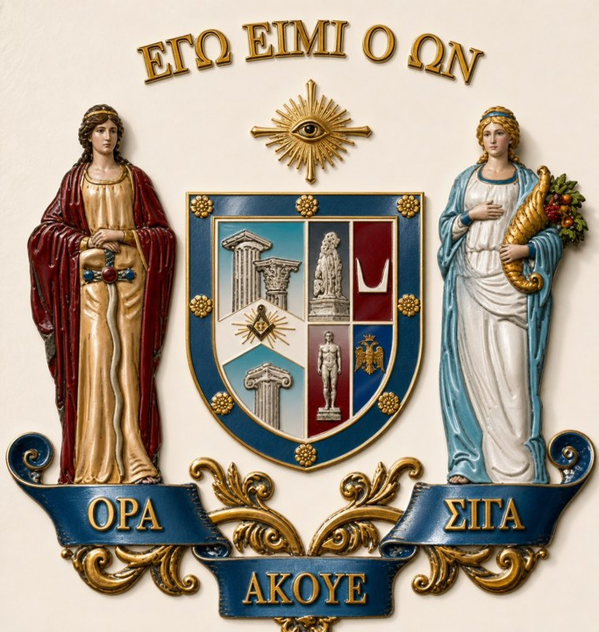

# Origin and Regularity — National Grand Lodge of Greece

<p align="center">
  
</p>

<p align="center"><strong>ΕΓΩ ΕΙΜΙ Ο ΩΝ</strong><br>
<em>A dossier for fraternal review: the regularity of origin, constitutional foundation and international recognitions of the National Grand Lodge of Greece (NGLG).</em></p>

<p align="center">
  <strong>Signed by the Grand Secretary, RW. Bro Dimitrios Skiadopoulos</strong>
</p>

---

## 🌐 Live page

**https://webappngdsib.github.io/ORIGIN-AND-REGULARITY-NGLG-CHANCELLOR/**

Open the page directly in a chosen language:

| Language | Link |
|---|---|
| 🇬🇧 English | https://webappngdsib.github.io/ORIGIN-AND-REGULARITY-NGLG-CHANCELLOR/?lang=en |
| 🇪🇸 Español | https://webappngdsib.github.io/ORIGIN-AND-REGULARITY-NGLG-CHANCELLOR/?lang=es |
| 🇧🇷 Português (Brasil) | https://webappngdsib.github.io/ORIGIN-AND-REGULARITY-NGLG-CHANCELLOR/?lang=pt |

> **Turning the live page on, once only:** go to **Settings → Pages** in this repository. Under *Build and deployment*, choose **Deploy from a branch**, then the branch **`main`** and the folder **`/ (root)`**, and click **Save**. The page is live at the address above after about a minute. Every later commit to `main` updates it automatically.

## 📄 Ready-made A4 PDFs

| Language | File | Pages |
|---|---|---|
| 🇬🇧 English | [NGLG-Origin-and-Regularity-EN.pdf](pdf/NGLG-Origin-and-Regularity-EN.pdf) | 23 |
| 🇪🇸 Español | [NGLG-Origen-y-Regularidad-ES.pdf](pdf/NGLG-Origen-y-Regularidad-ES.pdf) | 23 |
| 🇧🇷 Português (Brasil) | [NGLG-Origem-e-Regularidade-PT-BR.pdf](pdf/NGLG-Origem-e-Regularidade-PT-BR.pdf) | 23 |

---

## 📚 Contents of the dossier

| # | Chapter | What it presents |
|---|---|---|
| — | **Cover** | Coat of arms, title, key figures (83 Lodges · 1,800+ Brethren · 102 Recognitions · 20 Masonic Temples), issued by the Grand Secretary |
| — | **Contents** | Table of contents in the selected language |
| I | **Executive Summary** | The case for regular recognition, and **Key Facts**: regularity and recognition (UGLE *Policy and Practice* 1950–2000, p. 33), international standing (63 Grand Lodges in amity with UGLE, 47 CMI members, XX World Conference), and the NGLG today |
| II | **The Eight Basic Principles** | The basic principles for Grand Lodge recognition (as in the UGLE Book of Constitutions), plus membership, conduct and sovereignty |
| III | **A Regular Origin — 7 June 1986** | Origin: 7 February 1867 (the first Grand Orient in Greece), the founding document of the Grand Lodge of Greece (Office-bearers 1872–75 and its first eight Lodges) and 7 June 1986 (inauguration of the NGLG); The foundation by six regularly constituted Lodges, the 1993 recognition by UGLE, the Constitution, and the six founding Lodges |
| IV | **Chain of Recognition** | Detailed timeline from 1986 to today: UGLE (8 Sep 1993), Ireland (1 Oct 1994) and Scotland (4 May 1995), each with the original recognition letter, Spain, Italy, France, Ireland, Scotland, South Africa and Ecuador (1993–1995), with the emblems of the three Home Grand Lodges, coexistence with the Grand Lodge of Greece, and the difference between *recognition* and *regularity* |
| V | **The NGLG Today** | Wide photograph of the **Grand Meeting**, key figures, the Conference of Worshipful Masters, the Grand Meetings, and the cities where the NGLG is present |
| VI | **Leadership** | Full-height photograph of the **Grand Master**, MW Bro. Ioannis Benetatos; the 14 Grand Masters since 1986, beginning with the first Grand Master, Prof. Stephanos Paipetis (University of Patras) |
| VII | **The Masonic Temples** | The 20 Masonic buildings of the NGLG, and a photo gallery of temple interiors |
| VIII | **Register of the 102 Mutual Recognitions** | Chart by region, the full register with search, and the NGLG at the European Conference of Grand Secretaries and Grand Chancellors (Edinburgh, 11 Oct 2024, with the Grand Secretary as speaker; London, 9–10 Oct 2026) |
| IX | **Governance** | Administrative and Masonic structure; the 15 Masonic bodies and independent orders; the Medal of the Ambassador, the Jewel of the Grand Representatives and Honorary Members, and the Jewel of the Grand Master's Benevolent Fund (1986–2026) |
| X | **Charity and Masonic Heritage** | The Grand Charity of Greece (M.A.S.), with a link to [emste-charity.org](https://emste-charity.org/), and the NGLG Masonic stamps issued by ELTA in 2007 |
| XI | **Four Pillars of Regularity** | Lawful establishment · Unbroken lineage · Constitutional fidelity · Enduring recognition |
| XII | **Attestation** | Certification by the Grand Secretariat, with the full-height photograph and signature of **RW. Bro Dimitrios Skiadopoulos, Grand Secretary**, and contact details |

### Key facts

- **Founded:** 7 June 1986 in Athens, by 6 Lodges and about 250 Brethren
- **Lodges:** 83, in 5 Provinces and 1 District
- **Brethren:** more than 1,800
- **Cities:** 17 in Greece, plus Nicosia and Limassol in Cyprus
- **Masonic buildings:** 20
- **Mutual recognitions:** 102 worldwide
  - Europe 8
  - Africa 13
  - Asia 2
  - North & Central America and the Caribbean 37
  - South America 42
- **Grand Master:** MW Bro. Ioannis Benetatos (since 2024)
- **Grand Secretary:** RW. Bro Dimitrios Skiadopoulos

### The 20 Masonic Temples

Athens · Athens II · Piraeus · Thessaloniki · Patras · Corfu I · Corfu II · Corfu III · Rhodes · Zakynthos · Kalamata · Lamia · Larissa · Santorini · Lefkada · Kavala · Ioannina · Syros · Mykonos · Cyprus

---

## ✉️ Petition letter for mutual recognition

The page [`letter.html`](letter.html) is reserved for the Grand Secretariat and opens only with its access code. It holds a formal Masonic letter from the Grand Secretary, **addressed to the Grand Secretary of the other Grand Lodge**. It petitions that Grand Lodge for **mutual recognition** and the **reciprocal appointment of Grand Representatives**, and asks the Grand Secretary to convey the greetings of our Grand Master to his Grand Master and to place the petition before him. Open it with the **Petition letter PDF** button in the top bar of the dossier.

- **Recipient:** type the Grand Lodge, its Grand Master, its Grand Secretary, the city and country, and a reference number, and upload the logo of that Grand Lodge. The letter and the annex fill in automatically; the logo is fitted beside the recipient's address and in the annex, opposite the NGLG crest.
- **Languages:** 🇬🇧 English · 🇪🇸 Español · 🇧🇷 Português (Brasil).
- **Content:**
  - letterhead of the NGLG
  - the letter, bearing the signatures of **MW Bro. Ioannis Benetatos, Grand Master** and **RW. Bro Dimitrios Skiadopoulos, Grand Secretary**, with the seal of the National Grand Lodge of Greece
  - list of enclosures
  - an **Annex**: the *Instrument of Mutual Recognition and Exchange of Grand Representatives*, with five articles; the NGLG side is already signed and sealed, the other side is left for the recipient Grand Lodge
- **Export:** click **Export letter PDF** to get an A4 PDF of 3 pages.
- **Direct links:** `letter.html?lang=es`, or pre-filled: `letter.html?lang=en&gl=Grand%20Lodge%20of%20…&gm=MW%20Bro.%20…&gs=RW%20Bro.%20…&place=City%2C%20Country&ref=NGLG%2FGS%2F2026%2F001`

Blank, ready-to-fill PDFs:

| Language | File |
|---|---|
| 🇬🇧 English | [NGLG-Petition-Letter-EN.pdf](pdf/NGLG-Petition-Letter-EN.pdf) |
| 🇪🇸 Español | [NGLG-Carta-de-Peticion-ES.pdf](pdf/NGLG-Carta-de-Peticion-ES.pdf) |
| 🇧🇷 Português (Brasil) | [NGLG-Carta-de-Peticao-PT-BR.pdf](pdf/NGLG-Carta-de-Peticao-PT-BR.pdf) |

---

## 🖨️ How to export the PDF yourself

1. Open the live page and choose the language with the flag buttons 🇬🇧 🇪🇸 🇧🇷.
2. Click **Export A4 PDF**.
3. In the print dialog, choose **Save as PDF** and paper size **A4**, and turn on **Background graphics**.

The PDF layout works as follows:
- The cover is a full page.
- Every chapter starts on a new page.
- Every page has a footer with the signature line *"Grand Secretary RW. Bro Dimitrios Skiadopoulos"* and the page number (e.g. 5 / 23).
- The full register of 102 recognitions is always printed, even when a search is active.

For the best result, use Google Chrome or Microsoft Edge.

---

## 🌍 Amity Planet (website only)

Chapter VIII embeds the interactive globe [nglg-amity-planet.pages.dev](https://nglg-amity-planet.pages.dev) at half the screen height, to show the mutual recognitions around the world. It is shown on the website only and is left out of the PDF.

---

## 🖼️ Adding the photographs

The page has three photo slots:

| Photo | File name to upload | Shape |
|---|---|---|
| Grand Meeting (full width) | `assets/photos/grand-meeting.jpg` | wide, about 3 : 1 |
| Grand Master | `assets/photos/grand-master.jpg` | tall portrait, 1 : 2 (chapter VI, centred) |
| Grand Secretary | `assets/photos/grand-secretary.jpg` | tall portrait, 1 : 2 (chapter XII, beside the signature) |

There are two ways to add them:
- **For everyone:** upload the files to the `assets/photos/` folder on GitHub (*Add file → Upload files*), using exactly these names. They then appear on the live page and in every exported PDF.
- **On one computer only:** unlock editing with the padlock button in the top bar (Grand Secretariat access code), then click **Add photograph**. The photo is stored only in that browser. Visitors do not see these buttons.

**Temple photographs:** the gallery in chapter VII shows the photos listed in `NGLG_TEMPLE_GALLERY` in `assets/data-nglg.js` (files in `assets/photos/temples/`). To show a photo on a specific temple card, enter its path in that temple's `photo` field, for example `photo: "assets/photos/temples/temple-1.jpg"`.

---

## ✏️ Editing the content

| To change… | Edit the file |
|---|---|
| Any text, in any language | `assets/i18n.js` (sections `en`, `es`, `pt`) |
| The list of the 102 recognitions | `assets/data-recognitions.js` |
| Temples, Grand Masters, founding Lodges, city and country names | `assets/data-nglg.js` |
| Colours, fonts, print layout | `assets/style.css` |
| Page structure | `index.html` |
| Page logic (language, search, photos, PDF footer) | `assets/app.js` |

## 🗂️ Repository structure

```
index.html                     Main page
letter.html                    Petition letter for mutual recognition (with annex)
assets/
  style.css                    Screen and A4 print styling (navy · gold · ivory)
  app.js                       Language switching, register search, photo slots, PDF footer
  i18n.js                      All texts in English, Spanish and Brazilian Portuguese
  letter-i18n.js               Texts of the petition letter in the three languages
  data-recognitions.js         The 102 mutual recognitions
  data-nglg.js                 Temples, Grand Masters, founding Lodges, names
  nglg-crest.jpg               Coat of arms of the NGLG
  emblems/                     Emblems of UGLE, the Grand Lodge of Ireland and the Grand Lodge of Scotland
  photos/                      Grand Meeting, Grand Master, Grand Secretary and temple photographs
pdf/                           Ready-made A4 PDFs in the three languages
```

The site is a static website with no build step, so it works on GitHub Pages or any web host. To preview it locally, open `index.html` in a browser.

---

## 📬 Contact

| | |
|---|---|
| Website | [www.nglgreece.org](https://www.nglgreece.org) |
| Grand Secretary | grand.secretary@nglgreece.gr |
| Grand Chancellor | grand.chancellor@nglgreece.gr |
| Headquarters | Athens, Greece |

<p align="center"><em>Fraternity · Ethics · Progress</em><br>
<strong>RW. Bro Dimitrios Skiadopoulos</strong> — Grand Secretary, National Grand Lodge of Greece</p>
